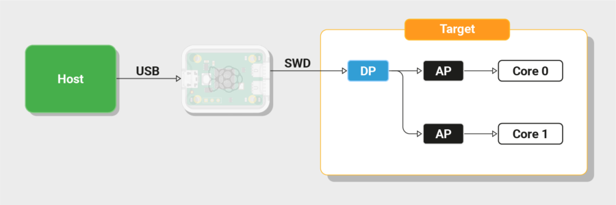

# SWD -  Open two-wire debug for RISC-V soft cores

## Debug a RISC-V core over two pins.

An Arm Serial Wire Debug front-end working on RISC-V DebugBus that JTAG DTM already uses. The Debug Module and the CPU are unchanged.

###  Why this exists

**The ratified debug specification defines only a JTAG transport.**

JTAG needs TCK, TMS, TDI and TDO, plus TRST where a reset line is wanted. Serial Wire Debug needs SWCLK and SWDIO. On a pin-constrained ASIC or a small FPGA board those two or three pins are contested, and on-chip debug is usually what gets cut.

Adding SWD to the RISC-V Debug Specification was requested and never adopted. [riscv-debug-spec issue #785](https://github.com/riscv/riscv-debug-spec/issues/785) tracks the original request.

[Raspberry Pi](https://www.raspberrypi.com/documentation/microcontrollers/debug-probe.html) shipped it as a custom Debug Transport Module, which the specification explicitly permits.

This project takes the same route for any Riscv Processor, in the open, under the upstream licences.This implements the RISC-V Debug Specification with a custom SWD transport.

### What changes

A new transport front-end: wire-level PHY, SW-DP register file, and a DMI gateway with clock-domain crossing. Two pads instead of four or five.

### What does not change

The Debug Module and the hart. Both are transport-agnostic in the specification, so a core that already has spec-compliant debug needs no redesign.

### What you get back

Stock GDB behaviour. Halt, examine registers and memory, set breakpoints, single-step, load code, all over an off-the-shelf CMSIS-DAP probe.

### What a RISC-V processor needs to implement a debug interface.

Debug Bus in RISC-V has provision to be transport-agnostic, which is the reason adding SWD meant writing a front-end rather than touching the core.

#### Debug Transport Module - This IP

Converts a wire protocol into Debug Module Interface reads and writes. The specification defines a JTAG DTM with `IDCODE`, `dtmcs` and `dmi` registers, and permits custom transports.

| Element | Need | Note |
| --- | --- | --- |
| DMI master | required | Address, data, read/write op, busy status for backpressure |
| Clock-domain crossing | required | The probe clock is asynchronous and intermittent. It stops when the probe idles, so the CDC cannot assume a free-running clock |
| Error and retry semantics | required | The host must distinguish "busy, retry" from "failed" |

#### Debug Module - From CPU Provider

A DMI slave holding the debug register file. Without at least one of a Program Buffer or System Bus Access, a debugger can read registers but not memory.

| Element | Need | Note |
| --- | --- | --- |
| `dmcontrol` | required | dmactive, haltreq, resumereq, ndmreset, hartsel |
| `dmstatus` | required | allhalted, anyhalted, allrunning, allresumeack, authenticated |
| `hartinfo`, `abstractcs`, `command`, `data0..N` | required | Abstract command interface and its data registers |
| Access Register command | required | Minimum viable command set: GPR and CSR read and write |
| Program Buffer `progbuf` | one of two | Feeds instructions to the halted hart; the usual route to memory access |
| System Bus Access | one of two | sbcs, sbaddress, sbdata. Bus master that reaches memory without halting |
| `abstractauto` | optional | Autoexec on data access. The difference between tolerable and glacial block download |
| Authentication `authdata` | optional | Needed on production parts; see layer 06 |

### The hart - From CPU Provider

Can be single or multiple HARTs. Debug Mode is a distinct operating mode above M-mode, with its own entry paths, register set and exit instruction.

| Element | Need | Note |
| --- | --- | --- |
| Debug Mode | required | Operating mode above M-mode |
| `dcsr`, `dpc` | required | Debug control and status, saved PC |
| `dscratch0`, `dscratch1` | with progbuf | Scratch for program-buffer execution |
| Halt entry paths | required | haltreq, `ebreak`, trigger fire, step completion, halt-on-reset |
| Park loop | required | A debug address region the hart enters on halt, where it spins and executes abstract commands |
| Redefined `ebreak` | required | In Debug Mode it returns to the park loop instead of trapping |
| `dret` | required | Exit from Debug Mode |
| step, stopcount, stoptime | required | Single-step, and freezing counters and timers while halted |

### What the SoC integrator must provide

The layer where SWD diverges from JTAG, and the one to settle before committing to a hardened flow.

| Element | Need | Note |
| --- | --- | --- |
| Two pins | required | SWCLK and SWDIO |
| Bidirectional pad for SWDIO | required | Output enable switchable per cycle. The protocol turns the line around inside one clock period |
| Input pad that can clock logic | required | SWCLK is externally driven and must reach sequential logic as a clock. The hardest constraint in a fixed harness |
| Live from power-up | required | A debug port that firmware has to enable cannot debug why the firmware did not run |
| Access control | production | Two exposed pins give full register and memory access. Either DM authentication or a fuse or lifecycle lock |

### Host side

| Element | Need | Note |
| --- | --- | --- |
| OpenOCD with a `riscv` target | required | Plus a target config describing the DTM and work area |
| GDB remote serial protocol | required | Standard client, no patches |
| A probe speaking the transport | required | CMSIS-DAP for SWD. Validated here with MCU-Link and Black Magic Probe |

## What this IP supplies, and what you already have.

| Layer | Supplied by | Detail |
| --- | --- | --- |
| Transport (DTM) | this IP | SwdPhy, SwdDp register file, DMI gateway with clock crossing |
| Debug Module | unchanged | Existing VexRiscv Debug Module, reached over the same DebugBus |
| Hart support | unchanged | Debug Mode, debug CSRs and park loop already in the core |
| SoC integration | supported | brings SWDIO out to SoC pins |
| Host side | supported | OpenOCD gateway and Black Magic Probe support |

## What an evaluation looks like.

The fastest route for a board or SoC team is a LiteX build, because two-wire debug is one flag away.

- Build a SoC with this SWD IP for your target board.
- Wire SWCLK and SWDIO to a CMSIS-DAP probe. Two signals and a ground.
- Run OpenOCD with the supplied target config, then attach GDB.
- Expect examine to pass, then `load`, a breakpoint, and `stepi` to behave as they do over JTAG.

A paid integration for one specific core, board and probe combination is available, with named software revisions, an agreed set of debug operations, acceptance tests, and a separate maintenance arrangement. The RTL stays open under its upstream licences either way.

### Is this standards-compliant RISC-V debug?

It implements the RISC-V Debug Specification with a custom SWD transport. The Debug Module and hart behaviour are per specification. The transport is not, because no ratified version of the specification defines an SWD DTM.

### Do I have to change my core?

No, if it already has a spec-compliant Debug Module and hart-side debug support. Those layers are transport-agnostic. You add a front-end and two pads.

### Why not just use JTAG?

Use JTAG if you have the pins. SWD matters when you do not: two signals instead of four or five, on parts where the pin budget is what forced debug off the chip in the first place.

### Which probes work?

Any CMSIS-DAP probe. Validated with an NXP MCU-Link and with Black Magic Probe, whose firmware now carries support for this path.

### Does stock OpenOCD work?

For raw-AP access, yes. For the full RISC-V target with GDB, not yet. That path needs the fork, which is the same position Raspberry Pi is in.

### Has it run in silicon?

Not yet. Everything above is simulation and FPGA, on a Digilent Arty with a real probe. Silicon validation is the open item, and the honest answer to give an adopter.

### What does it cost in area?

The transport front-end is small. The expensive parts of RISC-V debug are the trigger comparators and, where used, the System Bus Access master, and those are decisions you already made when you chose a core configuration.

## Where it would help to talk.

Three conversations are worth having: board and SoC teams feeling the pin-count pressure, debug tooling vendors who could help settle the upstreaming question, and education or research groups for whom two wires and a cheap probe is a lower barrier than a JTAG setup.

[Project overview and milestones](https://saketsinha.de/VexRiscv-Debug/) · [Standard debug in VexRiscv](https://saketsinha.de/standard-debug-vexriscv/)

